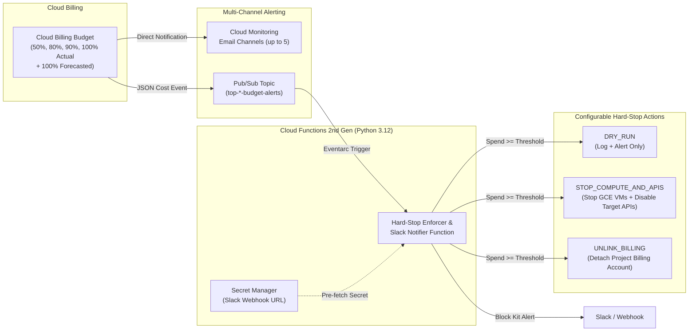

# GCP Billing Alerts & Programmatic Hard-Stop Guardrails

> [!SUMMARY] TL;DR
> Customer-ready Terraform module and Python 3.12 Cloud Run function (2nd Gen) for multi-threshold Cloud Billing alerts (Email + Slack Block Kit) and automated hard-stop spend enforcement (`DRY_RUN`, `STOP_COMPUTE_AND_APIS`, `UNLINK_BILLING`).

---

## Architecture Overview

Google Cloud Billing Budgets provide native spend threshold notifications (Actual & Forecasted) via email and Cloud Monitoring, but **do not natively enforce a hard spend cap** out of the box. This module wires Cloud Billing Budget telemetry to Cloud Pub/Sub and an Eventarc-triggered Cloud Run function (2nd Gen) to enforce a deterministic hard stop when spend crosses the configured ceiling.



### Supported Hard-Stop Enforcement Modes (`var.enforcement_mode`)

| Mode | Behavior | Blast Radius | Best For |
| :--- | :--- | :--- | :--- |
| **`DRY_RUN`** | Logs simulated enforcement to Cloud Logging and sends Slack/Email alerts without touching resources. | None (Safe) | Initial rollout, testing Pub/Sub routing, and verifying threshold alerts. |
| **`STOP_COMPUTE_AND_APIS`** *(Default)* | 1. Stops all `RUNNING` Compute Engine VMs across all zones.<br/>2. Disables configured high-spend APIs (`var.apis_to_disable_on_breach`, e.g., Vertex AI `aiplatform.googleapis.com`, Compute, Notebooks, Dataflow) while preserving storage buckets and project metadata. | Medium (Reversible per service/VM) | AI/ML sandboxes, Vertex AI / Gemini PoCs, and dev/test environments where you want to halt active compute/inference spend without losing access to Cloud Storage or logs. |
| **`UNLINK_BILLING`** | Calls `cloudbilling.projects.updateBillingInfo` with `billingAccountName: ""` to detach the project from the Billing Account. | **High / Nuclear** (Halts all billable services across the project) | Strict financial caps where zero additional spend is permitted under any circumstance. |

> [!WARNING]
> **Billing Telemetry Latency & Threshold Buffering**
> Google Cloud Billing usage reporting has an inherent latency between resource consumption and budget evaluation (ranging from minutes to a few hours depending on the service SKU). If a customer has a strict financial ceiling, set `hard_stop_threshold_percent = 0.90` or `0.95` (90%–95% of the monthly budget) to provide a safety buffer before actual charges reach 100%.

---

## Module File Inventory

| File | Purpose |
| :--- | :--- |
| `versions.tf` | Configures Terraform `>= 1.5.0`, `hashicorp/google ~> 5.0`, and the `google.billing` provider alias (`user_project_override = true`). |
| `variables.tf` | Input variables for project, billing account, budget thresholds, notification channels, and hard-stop enforcement mode. |
| `budgets.tf` | Ordered API enablement (`serviceusage` $\rightarrow$ `cloudresourcemanager` $\rightarrow$ downstream APIs) and `google_billing_budget.project_budget`. |
| `notifications.tf` | Central Pub/Sub topic, Cloud Monitoring email notification channels (up to 5), and Secret Manager Slack webhook secret. |
| `enforcer_function.tf` | Dedicated `sa-billing-enforcer` service account, mode-conditional IAM bindings, source archive bucket, and Cloud Functions 2nd Gen resource. |
| `outputs.tf` | Resource identifiers plus copy-paste `gcloud` commands for manual Billing Admin IAM binding and synthetic Pub/Sub testing. |
| `terraform.tfvars.example` | Annotated configuration template for customer environments. |
| `function/main.py` | Python 3.12 CloudEvent handler: decodes budget telemetry, pre-fetches Slack secrets, executes hard-stop actions, and sends Slack Block Kit cards. |
| `function/requirements.txt` | Pinned Python dependencies (`functions-framework`, `google-api-python-client`, `google-auth`, `google-cloud-secret-manager`). |

---

## Prerequisites & IAM Requirements

- **Terraform `>= 1.5.0`** and **Google Cloud SDK (`gcloud`)** authenticated via `gcloud auth application-default login`.
- **Target Project IAM (Terraform Operator)**: `roles/owner` or (`roles/editor` + `roles/resourcemanager.projectIamAdmin` + `roles/secretmanager.admin` + `roles/cloudfunctions.admin`).
- **Cloud Billing Account IAM**:
  - **Terraform Operator**: `roles/billing.costsManager` or `roles/billing.admin` on `var.billing_account_id` to provision the budget.
  - **Enforcer Service Account (`UNLINK_BILLING` mode only)**: `sa-billing-enforcer@<PROJECT_ID>.iam.gserviceaccount.com` requires `roles/billing.admin` on the Billing Account (in addition to `roles/billing.projectManager` on the project) to detach billing.
    - Set `grant_billing_account_iam = true` if the Terraform operator holds Billing Account Administrator privileges.
    - Leave `grant_billing_account_iam = false` (default) if Billing Account IAM is managed by a separate central FinOps team, and have them run the `manual_billing_admin_grant_command` Terraform output.

---

## Deployment Runbook

1. **Configure Variables**:
   ```bash
   cp terraform.tfvars.example terraform.tfvars
   ```
   Populate `project_id`, `billing_account_id`, `monthly_budget_amount`, `alert_emails`, and `enforcement_mode`.

2. **Initialize and Apply**:
   ```bash
   terraform init
   terraform plan
   terraform apply
   ```

3. **Bind Billing Account IAM (Only if `enforcement_mode = "UNLINK_BILLING"` and `grant_billing_account_iam = false`)**:
   ```bash
   eval "$(terraform output -raw manual_billing_admin_grant_command)"
   ```

---

## End-to-End Verification & Testing

Use the generated Terraform outputs to publish synthetic Cloud Billing Budget JSON payloads directly to the Pub/Sub topic:

1. **Test 80% Warning Notification (Safe — Does Not Trigger Enforcement)**:
   ```bash
   eval "$(terraform output -raw test_warning_alert_command)"
   ```

2. **Inspect Cloud Function Execution Logs**:
   ```bash
   gcloud functions logs read "$(terraform output -raw enforcer_function_name)" \
     --gen2 --region=asia-southeast1 --limit=20
   ```

3. **Test 105% Hard-Stop Breach**:
   > [!CAUTION]
   > Verify `enforcement_mode = "DRY_RUN"` before publishing a breach event in a live project unless you intend to actively stop VMs, disable APIs, or unlink billing.
   ```bash
   eval "$(terraform output -raw test_hard_stop_breach_command)"
   ```

---

## Recovery Runbook (Restoring a Project After a Hard Stop)

### Recovery from `STOP_COMPUTE_AND_APIS`
1. **Raise Budget Ceiling**: Update `monthly_budget_amount` in `terraform.tfvars` and run `terraform apply` so subsequent budget ticks do not re-trigger enforcement.
2. **Re-enable Billable APIs**:
   ```bash
   gcloud services enable aiplatform.googleapis.com compute.googleapis.com notebooks.googleapis.com dataflow.googleapis.com \
     --project=<PROJECT_ID>
   ```
3. **Restart Compute Engine VMs**:
   ```bash
   gcloud compute instances start <INSTANCE_NAME> --zone=<ZONE> --project=<PROJECT_ID>
   ```

### Recovery from `UNLINK_BILLING`
1. **Raise Budget Ceiling**: Increase `monthly_budget_amount` first so the next budget evaluation does not immediately detach billing again.
2. **Re-link Billing Account**:
   ```bash
   gcloud beta billing projects link <PROJECT_ID> --billing-account=<BILLING_ACCOUNT_ID>
   ```
3. **Re-enable Suspended Services**: Verify and re-enable any project APIs or workloads that were halted when billing was unlinked.

## Troubleshooting Common GCP Organization Errors

### 1. `IAMPolicy.SetIamPolicy: One or more users named in the policy do not belong to a permitted customer`

**Symptom:**
During `terraform apply`, `google_billing_budget.project_budget` fails with `Error 400: Precondition check failed` (`CostViewService.CreateCostView` $\rightarrow$ `IAMPolicy.SetIamPolicy: One or more users named in the policy do not belong to a permitted customer`).

**Root Cause:**
When a Cloud Billing Budget is linked to a Pub/Sub topic (`all_updates_rule.pubsub_topic`), Google Cloud Billing's backend automatically calls `SetIamPolicy` on the topic to grant `roles/pubsub.publisher` to its global service account: **`billing-budget-alert@system.gserviceaccount.com`**. Because this legacy Google-managed service account does not belong to your Google Workspace or Cloud Identity customer domain, projects enforcing Domain Restricted Sharing (`constraints/iam.allowedPolicyMemberDomains`) reject the IAM binding.

**Remediation Options:**

- **Option A — Automated Terraform Override (Sandbox / Non-Regulated Environments):**
  Set `relax_project_drs_for_billing_pubsub = true` in `terraform.tfvars` and run `terraform apply`. This provisions a project-level `google_project_organization_policy` override on `constraints/iam.allowedPolicyMemberDomains` (`allow { all = true }`) and waits 15 seconds for IAM propagation before creating the budget (requires `roles/orgpolicy.policyAdmin` on the project or organization).

- **Option B — Temporary Window + Immediate Re-Lock (Recommended for Regulated / GCC Environments):**
  Because `constraints/iam.allowedPolicyMemberDomains` is evaluated **only at the moment `SetIamPolicy` is called** and does not retroactively revoke existing IAM bindings, you can briefly open the policy on the project, apply the budget, and immediately restore strict Domain Restricted Sharing:
  ```bash
  # 1. Temporarily relax DRS on the target project only
  gcloud resource-manager org-policies allow iam.allowedPolicyMemberDomains --all \
    --project=<PROJECT_ID>

  # 2. Create the budget (allows Cloud Billing to bind billing-budget-alert@system.gserviceaccount.com)
  terraform apply

  # 3. Delete the project-level override so the project inherits strict Org-level DRS again
  gcloud resource-manager org-policies delete iam.allowedPolicyMemberDomains \
    --project=<PROJECT_ID>
  ```

### 2. `The CostView has different currency code <X> than its parent billing account <Y>`

**Symptom:**
`google_billing_budget.project_budget` fails with `INVALID_ARGUMENT: The CostView has different currency code SGD than its parent billing account USD`.

**Root Cause & Fix:**
Cloud Billing Budgets must match the ISO-4217 currency code of the parent Cloud Billing Account. Leave `budget_currency = ""` (the default) in `terraform.tfvars` so the budget automatically inherits the Billing Account's currency, or set `budget_currency` to the exact currency code of your Billing Account.
